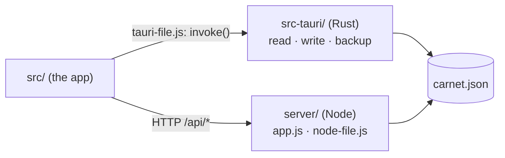
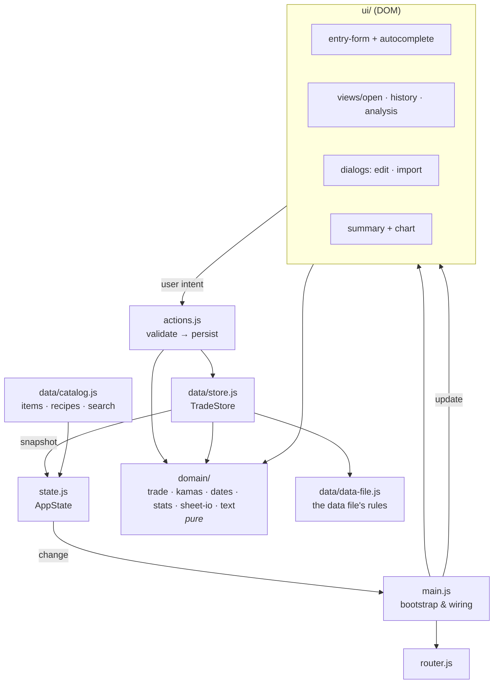

# Architecture

## Goals

1. Fast daily entry: a trade in a few seconds, sale in two clicks.
2. Trustworthy numbers: one place computes profit; the same functions feed every screen.
3. Easy to change: logic testable without a browser; storage swappable.
4. No toolchain for the app itself: plain ES modules, no dependencies, nothing to build.
5. Your data stays on your computer, in one readable file.

## Overview

The app is a web page (`src/`). It runs in one of two hosts, which both keep the same data
file with the same rules (`src/js/data/data-file.js`):

- **The desktop app** (`src-tauri/`, Tauri): a native window showing `src/` through the
  system's web engine (WebView2, WebKit). Four small Rust commands give the page its data file.
  This is what people install.
- **The local server** (`server/`, Node): serves `src/` to a browser, with a small JSON API over
  the data file. Used for development, the browser tests, and by anyone running from a copy of
  the repository.

## Layers of the page

| Layer                    | Depends on                          | Must not                          |
| ------------------------ | ----------------------------------- | --------------------------------- |
| `domain/`                | `config.js` only                    | touch the DOM, network or globals |
| `data/`                  | `domain/`, `config.js`              | touch the DOM                     |
| `actions.js`, `state.js` | `data/`, `domain/`                  | touch the DOM                     |
| `ui/`                    | everything above                    | write to storage directly         |
| `main.js`                | everything                          | contain business logic            |
| `server/`                | Node built-ins, `data/data-file.js` | import the rest of `src/`         |

## Data flow

One direction, with the stored data as the single source of truth:

1. The user acts (submit, _Vendu_, edit, import).
2. The UI calls an **action**. The action validates (`validateTrade`) and writes through the **store**.
3. The store delivers the new list of trades; `main.js` puts it in **state**.
4. State notifies `main.js`, which repaints only what changed (`paint(state, changedKeys)`):
   summary, tab counters, and the mounted view.

The UI never patches its own copy of the data after a write, which avoids "saved locally but
not really" bugs. The stores deliver our own writes before the save resolves, so this costs
nothing in responsiveness.

One deliberate exception: remembered unit prices are read once at start and shown as soon as
they are typed. Their writes merge only the changed prices, so a save made before the stored
prices have loaded never erases others.

Live updates (another browser tab, for the local server) can re-render the mounted view at any
moment, so views never keep user input only in the DOM: the sale form keeps its typed values in
the view (`open.js`), `renderKeepingFocus` restores focus and caret after a re-render, and the
history toolbar is not rebuilt while one of its controls has focus.

## Modules

### `domain/` (pure)

- `trade.js`: the `Trade` type, `normalizeTrade`, `validateTrade`, `profit` / `salePrice` /
  `auctionTax`, `markSold`, `toDocument`. Every screen gets profit from `profit()`, so the
  auction tax is applied in one place. `normalizeTrade` tolerates old documents and treats
  stored data as untrusted: every field the UI renders is type- and shape-checked (malformed
  recipe lines are dropped), on top of escaping at render time.
- `kamas.js`: forgiving amount parser and formatters (`1.8m`, `1,850,000.00`, `1 850 000`), and
  `evaluateKamas`, a small recursive-descent calculator (`1.2m + 350k`, `3 x 450k`) used by
  every kamas field the player types in; no `eval`. Imports keep using `parseKamas`.
- `dates.js`: ISO calendar dates, never timestamps, so days don't shift across time zones.
  `isIsoDate` accepts real days only ("2026-02-30" is rejected).
- `stats.js`: every aggregate shown on screen (`summarize`, `byCategory`, `byMonth`, `byItem`).
- `sheet-io.js`: spreadsheet paste parsing (rows checked with `validateTrade`), duplicate
  detection that counts occurrences, and a TSV export that re-imports without loss.
- `purchases.js`: purchases read from chat screenshots. `readOcrLine` matches each line the
  text reader found against `N x [Item] (price kamas)`, forgiving its usual slips ("komas",
  `Lx`, other brackets) but marking a line unsure when the price had to be forgiven, is not
  grouped by three, or has a digit read with low confidence. `readOcrLines` adds a `skipped`
  entry where the spacing between two purchase lines leaves room for one the reader missed;
  `ingredientPrices` turns the lots bought into a recipe's unit
  prices (names matched loosely); `combineReadings` keeps, line by line, the price most of a
  screenshot's readings agree on (sure only when all agree); `overlappingLines` finds lines repeated where two screenshots overlap; `reviewLines` builds
  the list the player checks.
- `text.js`: `normalize` (accent-, case- and punctuation-insensitive keys), `escapeHtml`, `plural`.

### `data/`

- `catalog.js`: `ItemCatalog` built from `dofus-data.json`; name lookup, ranked suggestions,
  `recipeCost`. Ranking lives here, not in the UI, so it is unit tested.
- `data-file.js`: the data file's rules, whatever the host: parse and validate it (an
  unreadable file is an error, never overwritten), back it up on opening, apply each change to
  a copy and write the whole file, one write at a time, keeping the change in memory only once
  the write succeeded. It reaches the disk through a `DiskFile` (`read`, atomic `write`,
  `backup`), so it runs in the page and in Node alike.
- `tauri-file.js`: the `DiskFile` of the desktop app, calling the shell's commands.
- `store.js`: the `TradeStore` interface and its implementations: `createDesktopStore(file)`
  (the data file in the page itself), `createLocalStore()` (the local server's API; follows
  other tabs through server-sent events and reloads the list on every reconnection) and
  `createMemoryStore()`. Also `withRetry` and `describeStoreError`. `main.js` picks the
  desktop store when `window.__TAURI__` exists, else the local store when `GET api/info`
  answers, else memory.

### Application

- `state.js`: `createState` returns `{ get, set, subscribe }`; `set` reports which keys changed.
- `actions.js`: `addTrade`, `updateTrade`, `sell`, `removeTrade`, `importDrafts`, `rememberPrices`.
  Failures throw `ActionError` whose message is ready to show; an import that stops part-way
  throws `ImportError` with the number of rows saved, so a retry resumes exactly there.
- `router.js`: maps `#en-cours`, `#historique`, `#analyse` to views; a default when no hash.

### `ui/`

- **View contract** (`views/view.js`): `mount(el)` binds delegated events once, `update(state)`
  re-renders, `unmount()` removes listeners. The router mounts one view at a time.
- `history.js` renders its toolbar once per mount and only re-renders the results, so the search
  box keeps focus while typing; the month list is refreshed when no toolbar control has focus.
- `entry-form.js` keeps the in-progress draft (category, recipe unit prices, whether the cost
  follows the recipe) locally; it is not app state because nothing else needs it.
- `dialogs.js` uses the native `<dialog>` (content is a `<form>`, so Enter saves; titled by
  `#dlg-title`): edit, import, and copy-by-hand when the clipboard is blocked. Deletion is a
  two-step button rather than a `window.confirm` pop-up.
- `kamas-field.js`: calculator behaviour for every `input.kamas` (delegated from the document):
  a bubble with the result while typing; on blur, what was typed becomes the amount in full,
  with its separators.
- `table.js`: `amountCell`, the amount cell of the tables (short, exact on hover) so they fit
  their card; `pills.js`: the trade type badge, the same in every list.
- `sort.js`: click-to-sort shared by Historique, Par objet (sortable headers) and En cours (a sort
  bar): columns describe their sort value and first direction; a second click reverses.
- `dismiss.js`: `closeOnClickOutside`, the one click-away-to-close behaviour, used by the dialog
  (`dialogs.js`, so every dialog content) and the recipe folds (`entry-form.js`). Any new panel
  that opens should use it rather than its own listeners.
- `hdv-tax.js`: the tax `<select>` options (form, sale form, edit dialog) and the rate the
  form remembers in `localStorage` (a per-device convenience; trades store their own rate).
- `dom.js`: `$`, `$$`, `closest` for delegated events, `toast`, `runAction`, `renderKeepingFocus`.
  The toast is a permanent live region; it moves into an open modal dialog, because the dialog's
  top layer would otherwise cover it. `runAction` shows `ActionError` messages as they are and
  logs anything else as a bug.
- `screenshot-ocr.js`: the offline text reader. It loads Tesseract (WebAssembly, English and
  French models, vendored in `src/vendor/tesseract/` by `npm run vendor:ocr`) only when a
  screenshot is read, and prepares each image first: enlarged when small, dark text on white
  in greys whatever the chat theme. Each screenshot is read three times at once, by three
  engines, with the greys more or less darkened, since each version misreads different
  digits; only the first also loads the French model, for item names.
- `purchase-import.js`: screenshots pasted anywhere, dropped on the form or picked are read
  in turn and used straight away: with a recipe shown (the form's `RecipeHook` and its
  "recipechange" event), the buttons move into the recipe box and `ingredientPrices` fills the
  unit prices; otherwise the total goes into the investment. "Vérifier (N)" opens
  the editable list (each line's picture, flags, running total) on a copy, kept only by
  "Utiliser". Changing the investment by hand or adding the trade forgets them.
- `chart.js` draws one SVG bar chart; a chart library would be most of the page weight for one chart.

### `src-tauri/` (desktop shell, Rust)

- `src/lib.rs`: the window, a single-instance guard (a second launch focuses the open window,
  so the data file has one writer), and the commands `data_file_path`, `read_data`,
  `write_data` (temporary file, fsync, rename) and `backup_data` (plus, once per app version,
  a `carnet.before-<version>.backup.json` that is never overwritten, the last 3 kept). The shell decides the file's
  location (`$CARNET_DATA`, else the per-user data folder); the page never passes a path. Unit
  tests cover the atomic write and the backup names.
- `tauri.conf.json`: the window, a strict content security policy (only the app's own files and
  Tauri's IPC; fonts ship in `src/fonts/`; `'wasm-unsafe-eval'` lets the text reader compile
  its WebAssembly), and the installers: NSIS and MSI in French on
  Windows, a universal `.dmg` (ad-hoc signed) on macOS, `.AppImage` and `.deb` on Linux. The
  version is read from `package.json`.
- `capabilities/default.json`: the main window gets Tauri's core permissions only.

### `server/` (Node, no dependencies)

- `main.js`: command line (`npm start`, `--port`, `--data`, `--static`). If the app already
  answers on the port, it says so and exits. It flushes pending writes on Ctrl+C, and prints
  French messages, since whoever runs the app reads them.
- `paths.js`: the default data location. That is the portable `data/` folder when it exists,
  else the same per-user folder as the desktop app.
- `node-file.js`: the `DiskFile` on Node's file system: atomic writes (temporary file, fsync,
  rename, retried briefly while Windows has the file locked) and the backup copy.
- `app.js`: serves `src/` and the JSON API (`/api/info`, `trades`, `prices`, `events`) over the
  data file. It only listens on 127.0.0.1 and refuses requests with a foreign `Host` (DNS
  rebinding) or `Origin` (other sites); writes must be `application/json`, so browsers cannot
  send them cross-site without a preflight, which the server never answers.

## Design decisions

| Decision                                | Why                                                                          | Trade-off                                                                              |
| --------------------------------------- | ---------------------------------------------------------------------------- | -------------------------------------------------------------------------------------- |
| One local JSON file for storage         | Private, works offline, easy to read, back up and restore.                   | One computer; no sync between devices.                                                 |
| Tauri for the desktop app               | Installers of a few MB using the system's web engine; the page is unchanged. | Rust toolchain to build; per-OS builds (done by CI); unsigned installers warn.         |
| One data-file module, two disks         | Desktop and server follow identical rules; only the disk access differs.     | `data-file.js` must stay free of browser- and Node-specific code.                      |
| The shell decides the file's path       | The page cannot read or write anything else on the computer.                 | A different location needs `$CARNET_DATA`.                                             |
| Fonts and catalog ship in `src/`        | Works offline; a strict content security policy with no third-party hosts.   | The catalog must be regenerated after game updates (`npm run build:catalog`).          |
| No framework, no build                  | Nothing to install or upgrade; source is what runs.                          | Manual DOM updates; kept manageable by the view contract.                              |
| Dedup key = date + investment           | Survives spelling fixes of item names. Matching counts occurrences.          | A re-typed row with another date or cost is not recognised as a duplicate.             |
| Offline OCR (Tesseract) for screenshots | No internet, no account or key; the screenshots never leave the computer.    | About 12 MB more in the app; readings can be wrong, so every line is shown for review. |
| French UI, English code                 | The player reads French item names in game; code follows common practice.    | —                                                                                      |

## Error handling

- An unreadable data file is reported (status line in the app, start-up message for the
  server) and left untouched: the desktop store refuses every write, the server does not start.
- A failed write is reported with its cause and changes nothing; later writes still work.
- Local server: a stopped server is reported in the status line ("Serveur local injoignable"),
  and the page reloads everything as soon as the event stream reconnects. Server errors worth
  retrying (HTTP 5xx) are retried up to 4 times with backoff.
- If the stored trades do not arrive within 10 s, the status line says so.
- If start-up itself throws, the status line and main panel say so instead of loading forever.
- A missing catalog only disables catalog suggestions and recipes; the rest of the app works.

## Testing

`npm run check` runs, in order:

1. Prettier in check mode (formatting).
2. ESLint: undefined names and unused code in every module, the UI included.
3. `tsc` over `src/js` with the JSDoc types. It also proves every import resolves to a real export.
4. `node:test` suites: the pure modules, the catalog, state, router and chart, the data file
   (`data-file.test.js`, on an in-memory disk), the stores, the actions, and the server: its
   disk access, API, security checks and command line (`server.test.js`, `main.test.js`), plus
   the browser's local store against the real server (`local-store.test.js`).
5. `unittest` for `scripts/build_catalog.py`, against a tiny SQLite file shaped like the real export.

`npm run check:rust` runs `cargo fmt --check`, Clippy with warnings as errors, and the Rust
unit tests of the shell.

`npm run test:coverage` fails below 90 % of lines or 85 % of branches in the modules the unit
tests load (everything except the DOM modules).

`npm run test:e2e` covers the DOM: Playwright drives the page in Chrome (`tests/e2e/`): the
entry form and recipe helper, sales, history filters, the edit dialog, import, export (with and
without clipboard access), analysis, navigation, the dark theme and phone widths. Most tests run
against `server/main.js --static`, so each starts with an empty in-memory notebook.
`local.spec.js` runs against a second, full server on a throwaway data file (saving, reloading,
sync between tabs, deletion, remembered prices). `desktop.spec.js` runs the desktop code path
against a fake shell (`installFakeDesktop`), including an unreadable file and hostile stored
data. Every test also fails on any page error, console error or failed request.

`npm run test:desktop` drives the **real built app** on Windows: WebView2 exposes the DevTools
protocol when asked (`WEBVIEW2_ADDITIONAL_BROWSER_ARGUMENTS`), so Playwright connects to the
app's window, on a temporary `$CARNET_DATA` file. It checks loading, the backup, saving through
the Rust commands, the bundled fonts, and that nothing logs to the console (so the security
policy blocks nothing). It runs locally, before each release: on GitHub's Windows runners the
app starts fine, but WebView2 ignores the DevTools arguments (its processes start with Tauri's
default arguments only, whether these come from the environment or the registry policy).

CI (`.github/workflows/ci.yml`) runs `check` and coverage on Node 22 and 24, the browser tests,
and on Windows `check:rust` and a build of the app, on every push to `main` and every pull
request. The release workflow builds the installers for the three systems.
