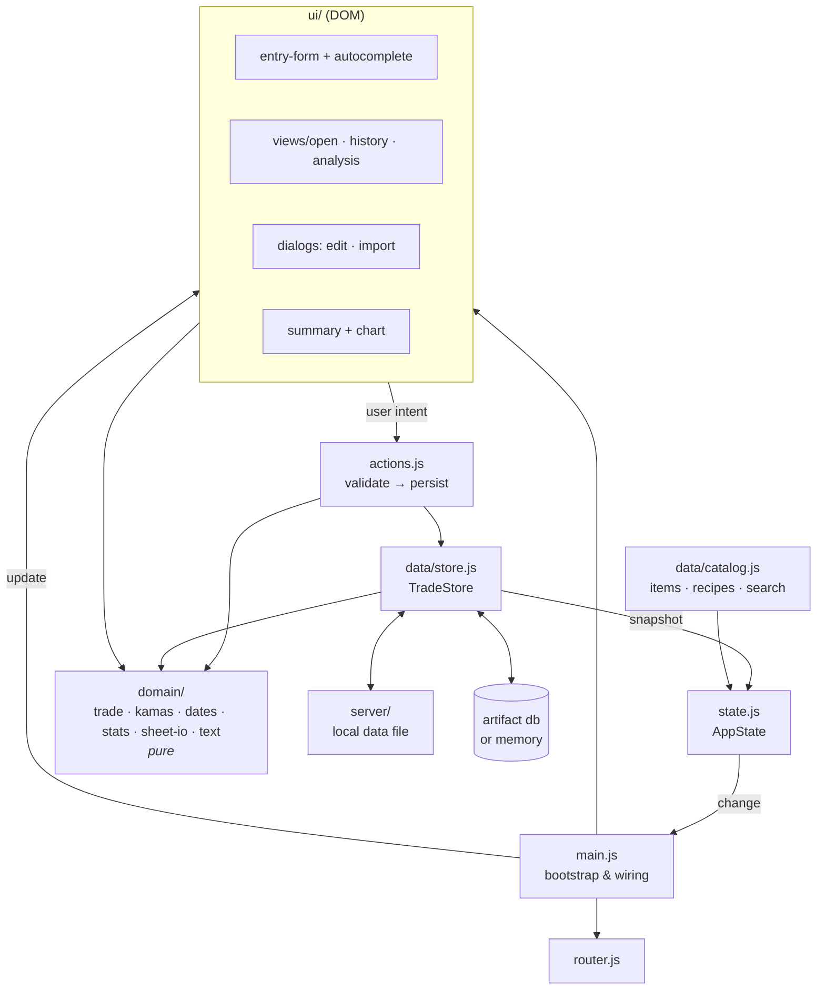

# Architecture

## Goals

1. Fast daily entry: a trade in a few seconds, sale in two clicks.
2. Trustworthy numbers: one place computes profit; the same functions feed every screen.
3. Easy to change: logic testable without a browser; storage swappable.
4. No toolchain: plain ES modules, no dependencies, nothing to build.
5. Your data stays on your computer, in one readable file.

## Layers

| Layer                    | Depends on             | Must not                          |
| ------------------------ | ---------------------- | --------------------------------- |
| `domain/`                | `config.js` only       | touch the DOM, network or globals |
| `data/`                  | `domain/`, `config.js` | touch the DOM                     |
| `actions.js`, `state.js` | `data/`, `domain/`     | touch the DOM                     |
| `ui/`                    | everything above       | write to storage directly         |
| `main.js`                | everything             | contain business logic            |
| `server/`                | Node built-ins only    | import browser code from `src/`   |

## Data flow

One direction, with the database as the single source of truth:

1. The user acts (submit, _Vendu_, edit, import).
2. The UI calls an **action**. The action validates (`validateTrade`) and writes through the **store**.
3. The store's live subscription delivers the new list of trades; `main.js` puts it in **state**.
4. State notifies `main.js`, which repaints only what changed (`paint(state, changedKeys)`):
   summary, tab counters, and the mounted view.

The UI never patches its own copy of the data after a write. That keeps every device and tab
consistent, and avoids "saved locally but not really" bugs. The platform shows our own
writes immediately (latency compensation), so this costs nothing in responsiveness.

One deliberate exception: remembered unit prices (`settings/prices`) are read once at start and
shown as soon as they are typed. Their writes are merges (`update`) of only the changed prices,
so a save made before the stored prices have loaded, or from another device, never erases others.

Live updates re-render the mounted view at any moment, so views never keep user input only in the
DOM: the sale form keeps its typed values in the view (`open.js`), `renderKeepingFocus` restores
focus and caret after a re-render, and the history toolbar is not rebuilt while one of its controls
has focus.

## Modules

### `domain/` (pure)

- `trade.js`: the `Trade` type, `normalizeTrade`, `validateTrade`, `profit` / `salePrice` /
  `auctionTax`, `markSold`, `toDocument`. Every screen gets profit from `profit()`, so the
  auction tax is applied in one place. `normalizeTrade` tolerates old documents and treats stored data as
  untrusted: every field the UI renders is type- and shape-checked (malformed recipe lines are
  dropped), on top of escaping at render time.
- `kamas.js`: forgiving amount parser and formatters (`1.8m`, `1,850,000.00`, `1 850 000`), and
  `evaluateKamas`, a small recursive-descent calculator (`1.2m + 350k`, `3 x 450k`) used by
  every kamas field the player types in; no `eval`. Imports keep using `parseKamas`.
- `dates.js`: ISO calendar dates, never timestamps, so days don't shift across time zones.
  `isIsoDate` accepts real days only ("2026-02-30" is rejected).
- `stats.js`: every aggregate shown on screen (`summarize`, `byCategory`, `byMonth`, `byItem`).
- `sheet-io.js`: spreadsheet paste parsing (rows checked with `validateTrade`), duplicate
  detection that counts occurrences, and a TSV export that re-imports without loss.
- `text.js`: `normalize` (accent-, case- and punctuation-insensitive keys), `escapeHtml`, `plural`.

### `data/`

- `catalog.js`: `ItemCatalog` built from `dofus-data.json`; name lookup, ranked suggestions,
  `recipeCost`. Ranking lives here, not in the UI, so it is unit tested.
- `store.js`: `TradeStore` interface with three implementations: `createLocalStore()` (the local
  server's data API), `createCloudStore(db)` (claude.ai artifact) and `createMemoryStore()`;
  `withRetry` for transient errors; `describeStoreError` for messages. `main.js` picks the cloud
  store inside claude.ai, else the local store when `GET api/info` answers, else memory. The
  local store follows changes from other tabs through server-sent events and reloads the list
  on every reconnection; the cloud store merges price writes and re-subscribes when the host
  drops the trades listener.

### `server/` (Node, no dependencies)

- `main.js`: command line (`npm start`, `--port`, `--data`, `--open`, `--static`). If the app
  already answers on the port, it just opens the browser on it. It flushes pending writes on
  Ctrl+C, and prints French messages, since whoever launches the app reads them.
- `paths.js`: the default data location. That is the portable `data/` folder when it exists,
  else the per-user folder, so updating the app never moves the data.
- `app.js`: serves `src/` and the JSON API (`/api/info`, `trades`, `prices`, `events`). It only
  listens on 127.0.0.1 and refuses requests with a foreign `Host` (DNS rebinding) or `Origin`
  (other sites); writes must be `application/json`, so browsers cannot send them cross-site
  without a preflight, which the server never answers.
- `file-store.js`: the data file. It is read once, and every change is applied to a copy, written
  atomically and only then kept in memory, one change at a time. Each start writes a backup.

### Distribution

`scripts/build-release.js` assembles `dist/carnet-de-kamas-<version>/`: `src/`, `server/`, a
minimal `package.json` (`"type": "module"`, no dependencies), and from `release/` the launchers
(`Carnet de Kamas.cmd` for Windows, `.command` for macOS and Linux) and `LISEZMOI.txt`. The
launchers check that Node.js is installed and run `node server/main.js --open`. Pushing a tag
`vX.Y.Z` runs `.github/workflows/release.yml`, which zips the folder on Linux (keeping the
`.command` executable bit) and publishes it as a GitHub release.

### Application

- `state.js`: `createState` returns `{ get, set, subscribe }`; `set` reports which keys changed.
- `actions.js`: `addTrade`, `updateTrade`, `sell`, `removeTrade`, `importDrafts`, `rememberPrices`.
  Failures throw `ActionError` whose message is ready to show; an import that stops part-way
  throws `ImportError` with the number of rows saved, so a retry resumes exactly there.
- `router.js`: maps `#en-cours`, `#historique`, `#analyse` to views; a default when no hash.

### `ui/`

- **View contract** (`views/view.js`): `mount(el)` binds delegated events once, `update(state)`
  re-renders, `unmount()` removes listeners. The router mounts one view at a time.
- `history.js` renders its toolbar once per mount and only re-renders the results, so the search
  box keeps focus while typing; the month list is refreshed when no toolbar control has focus.
- `entry-form.js` keeps the in-progress draft (category, recipe unit prices, whether the cost
  follows the recipe) locally; it is not app state because nothing else needs it.
- `dialogs.js` uses the native `<dialog>` (content is a `<form>`, so Enter saves; titled by
  `#dlg-title`): edit, import, and copy-by-hand when the clipboard is blocked. Deletion is a
  two-step button because the artifact sandbox blocks `window.confirm`.
- `kamas-field.js`: calculator behaviour for every `input.kamas` (delegated from the document):
  a bubble with the result while typing, replaced by the result on blur.
- `hdv-tax.js`: the tax `<select>` options (form, sale form, edit dialog) and the rate the
  form remembers in `localStorage` (a per-browser convenience; trades store their own rate).
- `dom.js`: `$`, `$$`, `closest` for delegated events, `toast`, `runAction`, `renderKeepingFocus`.
  The toast is a permanent live region; it moves into an open modal dialog, because the dialog's
  top layer would otherwise cover it. `runAction` shows `ActionError` messages as they are and
  logs anything else as a bug.
- `chart.js` draws one SVG bar chart; a chart library would be most of the page weight for one chart.

## Design decisions

| Decision                          | Why                                                                        | Trade-off                                                                         |
| --------------------------------- | -------------------------------------------------------------------------- | --------------------------------------------------------------------------------- |
| One local JSON file for storage   | Private, works offline, easy to read, back up and restore.                 | One computer; the server must be running (`npm start`).                           |
| Artifact `db` kept as an option   | The page still runs on claude.ai with no other change.                     | Two backends to keep working (both covered by tests).                             |
| One document per trade            | Small writes, no conflicts between rows, live updates per row.             | ~10k trades fit well under the 25,000-document cap; archive if ever needed.       |
| Remembered prices in one document | Read once at start; each save merges only the prices that changed.         | Last write wins for the same ingredient edited on two devices at the same moment. |
| Catalog as a static JSON file     | Browser fetches to other sites are blocked in artifacts; offline-friendly. | Must be regenerated after game updates (`npm run build:catalog`).                 |
| No framework, no build            | Nothing to install or upgrade; source is what runs.                        | Manual DOM updates; kept manageable by the view contract.                         |
| Dedup key = date + investment     | Survives spelling fixes of item names. Matching counts occurrences.        | A re-typed row with another date or cost is not recognised as a duplicate.        |
| French UI, English code           | The player reads French item names in game; code follows common practice.  | —                                                                                 |

## Error handling

- Local mode: a stopped server is reported in the status line ("Serveur local injoignable"),
  and the page reloads everything as soon as the event stream reconnects. A failed save shows
  why and changes nothing. An unreadable data file stops the server at start, with the file
  left untouched.
- Transient storage errors (`unavailable`, `resource_exhausted`) are retried up to 4 times with
  backoff; others fail fast with a clear message (`describeStoreError`).
- If the database does not answer within 10 s, the status line says so; the listener keeps
  retrying in the background. The first confirmed snapshot clears that warning (for viewers too).
- The one listener error that is not final, `unavailable` (the host stopped answering), is
  recovered by subscribing again, with backoff, up to 4 times; other listener errors are shown.
- If `claude.use("user")` fails, the database is still used (capabilities are settled separately).
- If start-up itself throws, the status line and main panel say so instead of loading forever.
- A missing catalog only disables catalog suggestions and recipes; the rest of the app works.
- Read-only viewers see the data; form and edit controls are disabled, and actions refuse
  writes as a second line of defence.

## Testing

`npm run check` runs, in order:

1. Prettier in check mode (formatting).
2. ESLint: undefined names and unused code in every module, the UI included.
3. `tsc` over `src/js` with the JSDoc types. It also proves every import resolves to a real export.
4. `node:test` suites: the pure modules, the catalog, state, router and chart, both stores (the cloud
   store against an in-memory fake of the `db` capability), and the actions through the memory store.
5. `unittest` for `scripts/build_catalog.py`, against a tiny SQLite file shaped like the real export.

`npm run test:coverage` fails below 90 % of lines or 85 % of branches in the modules the unit
tests load (everything except the DOM modules).

`npm run test:e2e` covers the DOM: Playwright drives the real page in Chrome
(`tests/e2e/`). It covers the entry form and recipe helper, sales,
history filters, the edit dialog, import, export (with and without clipboard access), analysis,
navigation, the dark theme and phone widths. A fake of the `db` and `user` capabilities
(`installFakeDb` in `tests/e2e/fixtures.js`) covers the cloud code path, read-only viewers and
hostile stored data. Most tests run against `server/main.js --static`, so each starts with an
empty in-memory notebook; `local.spec.js` runs against a second, full server on a throwaway
data file and checks saving, reloading, sync between tabs, deletion and remembered prices.
Every test also fails on any page error, console error or failed request.

The server has its own unit tests (`tests/server.test.js`: data file, API, security checks,
events), and `tests/local-store.test.js` runs the browser's local store against the real server.

CI (`.github/workflows/ci.yml`) runs `check` and coverage on Node 22 and 24, and the browser
tests on Node 24, on every push to `main` and every pull request.
